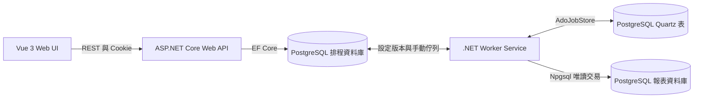

# SQL Crontab Scheduler

使用 Vue 3 管理 PostgreSQL 唯讀 SQL 排程，支援 Cron 預覽、手動執行、暫停與恢復、執行歷史和狀態總覽。

## 架構



- **API** 驗證排程表單、帳號和角色。Job 設定及操作稽核一起提交，手動執行回傳 202 與請求 ID，可用此 ID 查詢執行明細。
- **Worker** 每 2 秒以設定版本同步 Quartz，使用請求 ID 投遞手動觸發。排程修改返回後，列表會顯示等待同步，直到 Worker 從 Quartz 寫回目前的下次執行時間。API 可獨立啟停。
- **Quartz** 使用 PostgreSQL 持久化、單一 Worker lease 及相同 JobKey 的互斥執行，預設最多四個不同 Job 同時執行。預設準時觸發，超過 30 秒進入 Quartz misfire 判定時，週期排程跳過逾期時點，待處理的手動請求會補觸發。已開始的執行以獨立歷史記錄追蹤，處理完成後才保存終態。
- **SQL Executor** 使用受限的 Npgsql 目標憑證、唯讀交易、資料庫 Guard、總時限及取消。最多計數 10,000 筆，歷史記錄顯示計數與是否達上限。逾時、取消及 SQL 錯誤均寫成受控診斷碼。目標查詢只執行一次。
- **權限** 管理員管理所有 Job，一般使用者可查看、管理及執行自己建立的 Job。管理員專用連線僅能由管理員建立自己的 Job 使用。API 使用 HttpOnly Cookie、SameSite Strict、寫入請求標頭防 CSRF 及登入速率限制。受核准的連線 API 僅回傳 ID 與顯示名稱。

Worker 運作中可暫停已有排程。手動執行允許已啟用但暫停的 Job。請求提交後若設定已有新版本，舊請求列為 `Skipped`。意外停止後持續顯示為 `Running` 的紀錄會在下次啟動標為 `Cancelled`，並提供中斷診斷。未來進入 Quartz Cluster 前，需改用叢集 check-in、跨節點執行擁有者與過期回收，再啟用 `UseClustering`。

## 版本

| 元件 | 版本 |
| --- | --- |
| .NET / ASP.NET Core / EF Core | .NET 10 LTS，EF Core 與 ASP.NET Core 套件 10.0.15 |
| Quartz.NET | 3.22.11，PostgreSQL 官方相同版本 schema |
| PostgreSQL / Npgsql | PostgreSQL 17，Npgsql 與 EF Core provider 10.0.4 |
| Node.js / npm | 建議 Node.js 24 LTS。驗證環境 Node 24.22.3、npm 11.19.1 |
| Vue / Vite / Vitest | 3.5.46 / 7.3.8 / 4.1.12 |
| Router / Pinia / Element Plus | 4.6.5 / 3.0.4 / 2.14.8 |
| Axios / Monaco Editor | 1.21.1 / 0.57.0 |

## Windows 本機啟動

以 PowerShell 7.4 以上開啟專案目錄。先確認工具已安裝。

```powershell
dotnet --list-sdks
node --version
npm --version
git --version
psql --version
```

缺少工具時，使用 Windows 的官方安裝程式。已配置 winget 的環境可選用 `winget install Microsoft.DotNet.SDK.10`、`winget install OpenJS.NodeJS.LTS`、`winget install Git.Git` 及 `winget install Microsoft.PowerShell`。PostgreSQL 可用 Windows 安裝程式，安裝完將 `psql.exe` 的目錄加入 PATH。資料庫範例也可在已啟用的本機 Docker PostgreSQL 17 上操作。 [PostgreSQL Windows 下載](https://www.postgresql.org/download/windows/)

### 1. 建立本機開發資料庫

下面命令使用 PostgreSQL 管理帳號 `postgres` 與本機 port 5432。初始化腳本請在新建的本機開發資料庫執行。

```powershell
$env:SCHEDULER_METADATA_PASSWORD = [Convert]::ToHexString([Security.Cryptography.RandomNumberGenerator]::GetBytes(24))
$env:SCHEDULER_READER_PASSWORD = [Convert]::ToHexString([Security.Cryptography.RandomNumberGenerator]::GetBytes(24))
psql -X -h 127.0.0.1 -U postgres -d postgres -f .\database\bootstrap-metadata.sql
psql -X -h 127.0.0.1 -U postgres -d postgres -v ON_ERROR_STOP=1 -c "CREATE DATABASE scheduler_reports"
psql -X -h 127.0.0.1 -U postgres -d scheduler_reports -f .\database\target-readonly.sql
psql -X -h 127.0.0.1 -U postgres -d scheduler_reports -f .\database\demo-data.sql
$env:PGPASSWORD = $env:SCHEDULER_METADATA_PASSWORD
psql -X -h 127.0.0.1 -U scheduler_metadata -d scheduler -v ON_ERROR_STOP=1 -f .\database\quartz-postgres.sql
Remove-Item Env:PGPASSWORD

$metadata = "Host=127.0.0.1;Port=5432;Database=scheduler;Username=scheduler_metadata;Password=$env:SCHEDULER_METADATA_PASSWORD"
$reports = "Host=127.0.0.1;Port=5432;Database=scheduler_reports;Username=scheduler_query_reader;Password=$env:SCHEDULER_READER_PASSWORD"
```

### 2. 設定服務、帳號與遷移

```powershell
$adminHash = & .\scripts\New-PasswordHash.ps1
$userHash = & .\scripts\New-PasswordHash.ps1

Push-Location .\backend
dotnet tool restore
dotnet user-secrets set "ConnectionStrings:Scheduler" $metadata --project src/Scheduler.Api
dotnet user-secrets set "ConnectionStrings:Scheduler" $metadata --project src/Scheduler.Worker
dotnet user-secrets set "TargetConnections:DemoReports" $reports --project src/Scheduler.Worker
dotnet user-secrets set "Auth:Users:0:Username" "admin" --project src/Scheduler.Api
dotnet user-secrets set "Auth:Users:0:Role" "Admin" --project src/Scheduler.Api
dotnet user-secrets set "Auth:Users:0:PasswordHash" $adminHash --project src/Scheduler.Api
dotnet user-secrets set "Auth:Users:1:Username" "operator" --project src/Scheduler.Api
dotnet user-secrets set "Auth:Users:1:Role" "User" --project src/Scheduler.Api
dotnet user-secrets set "Auth:Users:1:PasswordHash" $userHash --project src/Scheduler.Api
$env:ASPNETCORE_ENVIRONMENT = "Development"
dotnet ef database update --project src/Scheduler.Infrastructure --startup-project src/Scheduler.Api
Pop-Location

$env:PGPASSWORD = $env:SCHEDULER_METADATA_PASSWORD
psql -X -h 127.0.0.1 -U scheduler_metadata -d scheduler -f .\database\register-demo-connection.sql
Remove-Item Env:PGPASSWORD, Env:SCHEDULER_METADATA_PASSWORD, Env:SCHEDULER_READER_PASSWORD
Remove-Variable adminHash, userHash, metadata, reports
```

### 3. 啟動三個程序

從專案目錄開啟三個終端機。使用 Development，讓 .NET 載入剛設定的 User Secrets。

```powershell
dotnet run --project .\backend\src\Scheduler.Api --launch-profile Local
```

```powershell
$env:DOTNET_ENVIRONMENT = "Development"
dotnet run --project .\backend\src\Scheduler.Worker --no-launch-profile
```

```powershell
Set-Location .\frontend
npm ci
npm run dev
```

瀏覽 `http://localhost:5173` 並使用上一步設定的帳號與密碼。Vite 將 `/api`、`/health` 及 `/openapi` 轉送到 `http://127.0.0.1:5058`，可用 `API_PROXY_TARGET` 覆寫。

- `GET /health/live` 檢查 API 進程，`GET /health` 檢查 metadata 資料表就緒。
- 開發環境的 OpenAPI 文件在 `/openapi/v1.json`，生產環境限管理員存取。
- 生產環境對外使用 HTTPS，以同一個 Origin 提供 `frontend/dist` 與 API 代理，將 Vue Router 的非 API 路徑回退至 `index.html`。API 與 Worker 連線密碼透過受管祕密注入。可選擇受權限保護的 `Auth__DataProtectionKeyPath` 持久化 API Cookie 加密金鑰，並於平台層保護金鑰。如果使用預設的程序內金鑰，API 重啟後須登入。

## 操作驗收

1. 登入、點選「新增排程」，填寫名稱，選擇「示範報表資料庫」。
2. 在 Monaco Editor 輸入 `SELECT * FROM report.daily_totals;`。選擇分鐘間隔 5 並保持啟用。
3. 確認預覽顯示 `0 0/5 * * * ?`、下次時間和未來五次時間，然後儲存。
4. 排程列表在 Worker 同步後顯示下次執行時間。按「立即執行」，到執行紀錄確認為手動、狀態成功及讀取兩筆。到達預計時間後可看到週期觸發的新紀錄。
5. 從排程操作選單暫停及恢復。停止 Worker、啟動 Worker，確認下次執行時點及既有執行紀錄仍存在。

排程時區預設 `Asia/Taipei`，預覽以排程時區顯示。列表可切換顯示時區，歷史的時間範圍選擇器標示瀏覽器時區並傳送 UTC。月份沒有指定日期時跳過該月。Quartz 依 IANA 時區規則計算夏令時間邊界。分鐘間隔對應 Quartz 的分鐘欄位，每個整點重新計算步進，例如 7 分鐘會從 `:56` 接到下一個 `:00`。

## 建置與測試

```powershell
Set-Location .\backend
dotnet build .\SqlCrontabScheduler.sln
dotnet test .\SqlCrontabScheduler.sln --no-build

Set-Location ..\frontend
npm ci
npm run build
npm test
```

xUnit 排程測試涵蓋五種類型、時區、月份及閏日。PostgreSQL 整合測試需要使用上面腳本全新初始化的隔離測試資料庫，包含已套用的 EF、Quartz schema、唯讀 Guard 與示範資料。將其連線字串分別設定成 `SCHEDULER_TEST_METADATA` 和 `SCHEDULER_TEST_TARGET`，停止該測試資料庫對應的外部 Worker，再執行 `dotnet test`。整合測試會寫入測試 Job 及稽核資料、啟動自己的 Worker，並等候下一分鐘的 Quartz 觸發。未設定兩個變數時，依賴 PostgreSQL 的測試會標為跳過。

資料庫設定、權限與保留策略請見 [database/README.md](database/README.md)。
